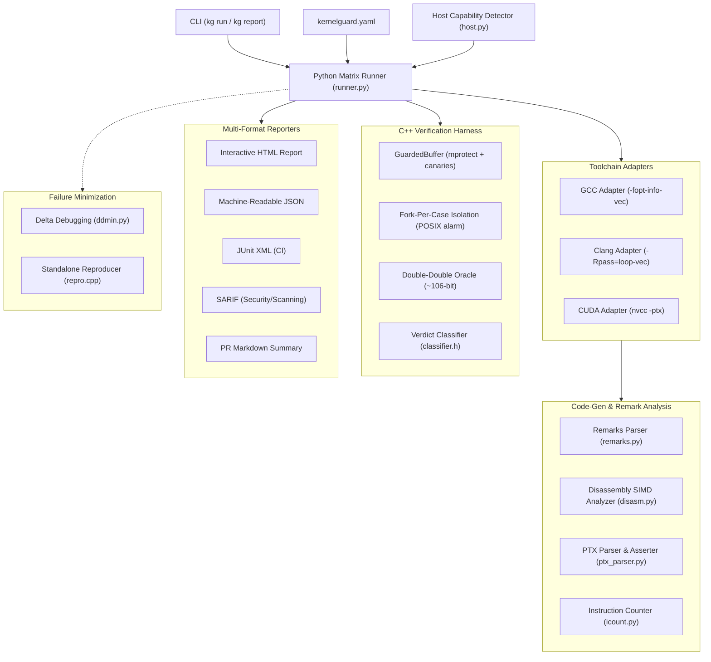

# KernelGuard System Architecture

## Architecture Overview

KernelGuard is structured into two decoupled, synergistic layers:
1. **C++ Verification Harness (`kernelguard_core` & `kg_harness`):** High-performance, isolated kernel execution engine featuring double-double reference arithmetic, `mprotect` guard pages, canary buffers, and fork-per-case process isolation.
2. **Python Orchestration Engine (`kg` & `kernelguard`):** Multi-toolchain matrix runner, compiler optimization remarks parser, disassembly SIMD analyzer, PTX inspection parser, delta-debugging failure minimizer, regression gatekeeper, and multi-format report generator.

## Core Modules

### 1. C++ Verification Core (`include/kernelguard/`)
- `double_double.h`: Dekker/Knuth 2Sum & 2Prod error-free transformations providing ~106 bits significand precision for exact float32 comparisons.
- `memory_guard.h`: `mmap`/`mprotect` buffer allocations bounded by `PROT_NONE` guard pages, 64-byte canaries, and pre-fill patterns.
- `isolation.h`: Fork-per-case test runner with pipe IPC, signal catching (`SIGSEGV`, `SIGBUS`, `SIGFPE`, `SIGABRT`), and `alarm()` timeouts.
- `classifier.h`: Contract evaluation (`exact`, `ulp(k)`, `bound`), FTZ/DAZ ablation, and FMA contraction diagnosis.
- `harness.h`: Kernel registry, standard and quick test distributions (uniform, subnormal, cancellation, special values, misalignments).

### 2. Python Orchestration Core (`python/kernelguard/`)
- `config.py`: Validated YAML configuration loader.
- `host.py`: Host CPU SIMD (NEON, AVX2, AVX512) and GPU/CUDA capability discovery.
- `toolchains/`: Compiler adapters for GCC, Clang, and NVCC.
- `analysis/`: Parsers for GCC/Clang vectorization remarks, disassembly instruction analysis, and PTX assembly inspection.
- `minimization/`: Delta debugging minimizer (`ddmin`) and standalone reproducer bundle generator.
- `baseline.py`: Regression lockfile manager (`kernelguard_lock.json`).
- `reporting/`: Generators for HTML, JSON, JUnit XML, SARIF, and Markdown.
